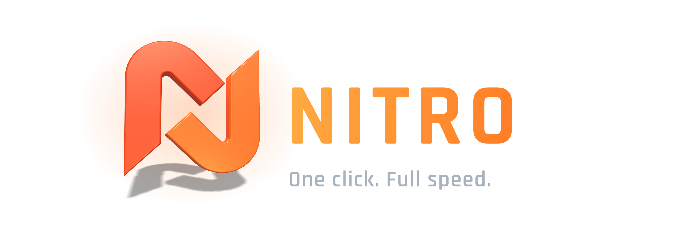
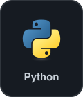
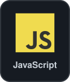
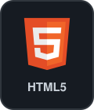
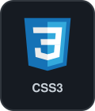
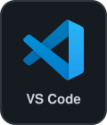
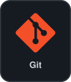
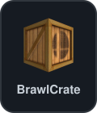
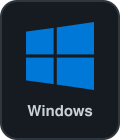

<picture>
<source media="(prefers-color-scheme: light)" srcset="assets/hero-light.webp">

</picture>

## What it does

<dl>
<dt>&nbsp;&nbsp;Play in one click</dt>
<dd>Sets the mod up in Dolphin and starts the game.</dd>
<dt>&nbsp;&nbsp;Always up to date</dt>
<dd>Downloads only changed files and checks every one. Failed downloads retry on their own.</dd>
<dt>&nbsp;&nbsp;Updates itself</dt>
<dd>New launcher versions come from the releases and are verified before they replace the old exe.</dd>
<dt>&nbsp;&nbsp;Mii editor</dt>
<dd>Pick every part visually, with a live preview.</dd>
<dt>&nbsp;&nbsp;Performance mode</dt>
<dd>Starts Dolphin with settings tuned for speed. Your own Dolphin settings are not changed.</dd>
<dt>&nbsp;&nbsp;My Stuff</dt>
<dd>Drop your own files, like music, into a folder and the launcher adds them to the mod.</dd>
<dt>&nbsp;&nbsp;16 languages</dt>
<dd>Switch any time in Settings.</dd>
<dt>&nbsp;&nbsp;Your saves stay yours</dt>
<dd>The launcher never installs, replaces or deletes save data.</dd>
</dl>

## Get started

1. **Download** `MarioKartNitro.exe` from the [latest release](../../releases/latest).
2. **Set it up.** Point it to `Dolphin.exe` and your own game file.
3. **Sync the mod.** The first launch downloads everything for you.
4. **Press Play.** Updates are checked every time you open the launcher.

> **You need** Windows 10 or 11, [Dolphin](https://dolphin-emu.org/) with Riivolution support, and your own Mario Kart Wii disc image (ISO or WBFS). This project does not provide one.

## Built with

 

<h3 align="center">License and community</h3>

Source-available under the <a href="LICENSE.txt">NitroForge Source-Available License 1.0</a>. 
You can read the code, play and stream with the launcher, and send improvements. 
Redistributing it, building other launchers from it, or selling it needs written permission. 
Third-party parts and their licenses are listed in <a href="THIRD_PARTY_NOTICES.md">THIRD_PARTY_NOTICES.md</a>. 
Questions, bugs, or just want to chat? Join the <a href="https://discord.gg/AhkHNPG65G">Discord</a>.

 

