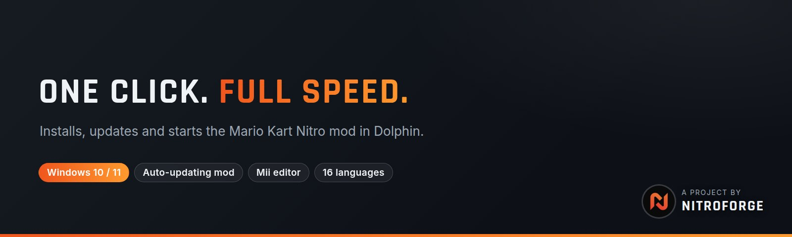

 

 

### [Download the launcher](../../releases/latest) &nbsp;·&nbsp; [Get help on Discord](https://discord.gg/AhkHNPG65G)

## What it does

| | |
|---|---|
| **Play in one click** | Sets the mod up inside Dolphin's `Load/Riivolution` folder and starts the game. |
| **Keeps the mod current** | Syncs from [Nitropack](https://github.com/nitroforge/Nitropack) and downloads only files that changed. Every file is checked against its hash, and failed downloads retry on their own. |
| **Updates itself** | New launcher versions come from this repo's releases, are checked against a checksum, and replace the old exe. |
| **Mii editor** | Pick every part visually, with a live preview beside it. |
| **Performance mode** | One switch that starts Dolphin with settings tuned for speed. Your own Dolphin settings are not changed. |
| **My Stuff** | Drop your own files, like music, into a folder and the launcher puts them into the mod for you. |
| **16 languages** | Switch any time in Settings. |
| **Your saves stay yours** | The launcher never installs, replaces or deletes save data. |

## What you need

- Windows 10 or 11
- [Dolphin](https://dolphin-emu.org/) with Riivolution support
- Your own Mario Kart Wii disc image (ISO or WBFS). This project doesn't provide one and never will.

## Get started

1. Download `MarioKartNitro.exe` from the [Releases](../../releases/latest) page.
2. Run it and point it to `Dolphin.exe` and your game file.
3. Let it download the mod the first time.
4. Press **Play**.

Updates are checked every time the launcher opens.

## Where things come from

| What | Source | How it arrives |
|---|---|---|
| Mod files | [`Nitropack`](https://github.com/nitroforge/Nitropack) | Incremental, hash-checked sync |
| Launcher | [Latest release](../../releases/latest) | Prompt, then the exe is swapped and restarted |

## FAQ

<b>Where does the launcher put the mod?</b>

In Dolphin's own user folder, under `Load/Riivolution`. Nothing is installed anywhere else.

<b>Will it touch my save files?</b>

No. Save data under `riivolution/save` is never downloaded, replaced or deleted by the launcher. The game creates it on your PC the first time you play.

<b>I get error 22005 when going online.</b>

That error means the save profile belongs to a different console. Close Dolphin, then rename
`Dolphin\User\Load\Riivolution\riivolution\save\NitroWFC\RMCP\rksys.dat` to `rksys.dat.bak` (use `RMCE` for the US version) and start the game again.
A new save should be created from your normal Mario Kart Wii save. Only do this if you have the error: a working save has your progress in it.

<b>The download failed or says GitHub isn't serving a file.</b>

The launcher retries by itself. If it still fails, wait a few minutes and press Play again. Everything that already downloaded is kept.

<b>Do you provide the game?</b>

No. You need your own copy of Mario Kart Wii.

## License

GPL v3, see [LICENSE.txt](LICENSE.txt). Third-party parts and their licenses are listed in [THIRD_PARTY_NOTICES.md](THIRD_PARTY_NOTICES.md).

## Community

Questions, bugs, or just want to chat? Come to the [Discord](https://discord.gg/AhkHNPG65G).

A project by <b>NitroForge</b>. Mario Kart Nitro is a fan project. It is not affiliated with or endorsed by Nintendo. Mario Kart and Wii are trademarks of Nintendo.
