

<picture>
<source media="(prefers-color-scheme: dark)" srcset="assets/banner-dark.png">
<source media="(prefers-color-scheme: light)" srcset="assets/banner-light.png">

</picture>

## What it does

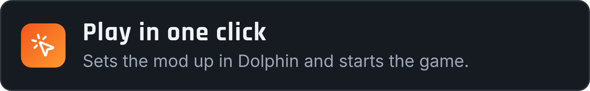 
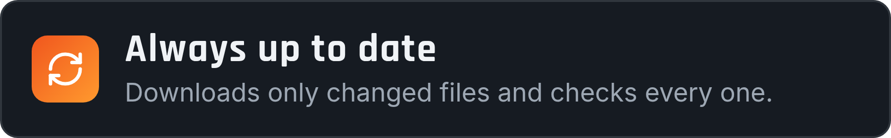 
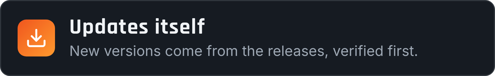 
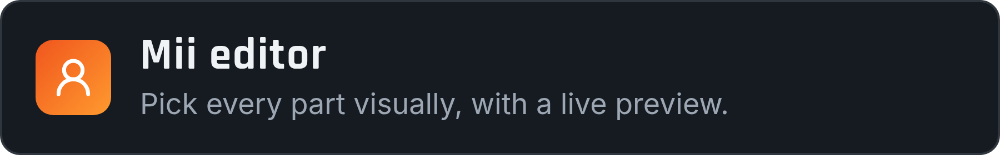 
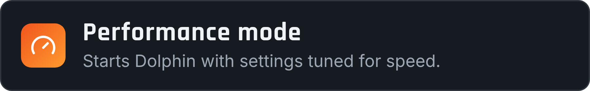 
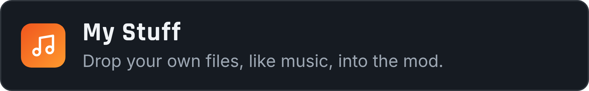 
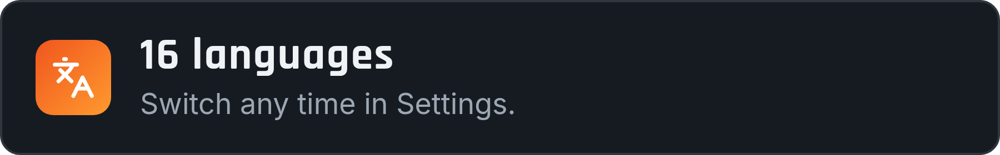 
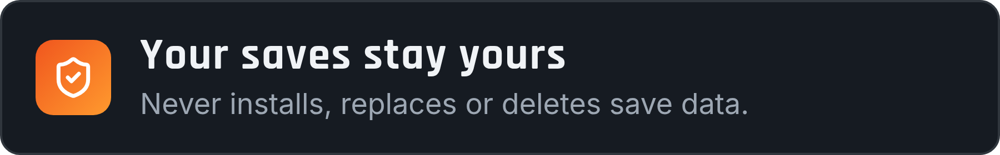

## Get started

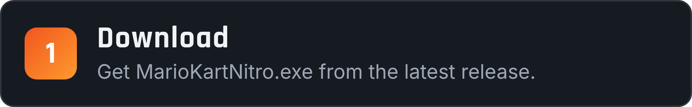 
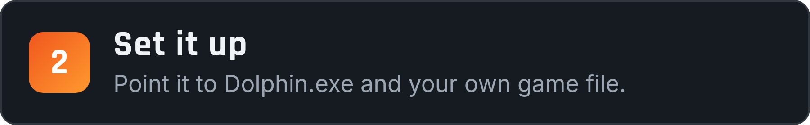 
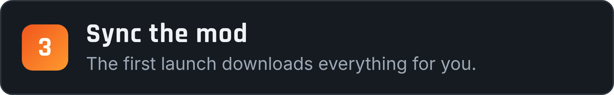 
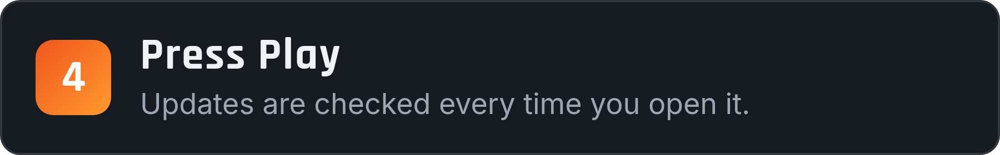

**You need:** Windows 10 or 11, [Dolphin](https://dolphin-emu.org/) with Riivolution support, and your own Mario Kart Wii disc image (ISO or WBFS). This project does not provide one.

## FAQ

<b>Where does the launcher put the mod?</b>

 
In Dolphin's own user folder, under <code>Load/Riivolution</code>. Nothing is installed anywhere else.

<b>Will it touch my save files?</b>

 
No. Save data under <code>riivolution/save</code> is never downloaded, replaced or deleted by the launcher. The game creates it on your PC the first time you play.

<b>I get error 22005 when going online.</b>

 
That error means the save profile belongs to a different console. Close Dolphin, then rename
<code>Dolphin\User\Load\Riivolution\riivolution\save\NitroWFC\RMCP\rksys.dat</code> to <code>rksys.dat.bak</code> (use <code>RMCE</code> for the US version) and start the game again.
A new save is created from your normal Mario Kart Wii save. Only do this if you have the error, because a working save holds your progress.

<b>The download failed or says GitHub is not serving a file.</b>

 
The launcher retries by itself. If it still fails, wait a few minutes and press Play again. Everything that already downloaded is kept.

<b>Do you provide the game?</b>

 
No. You need your own copy of Mario Kart Wii.

## Built with

## License and community

GPL v3, see [LICENSE.txt](LICENSE.txt). Third-party parts and their licenses are listed in [THIRD_PARTY_NOTICES.md](THIRD_PARTY_NOTICES.md).
Questions, bugs, or just want to chat? Join the [Discord](https://discord.gg/AhkHNPG65G).

 

A project by <b>NitroForge</b>. Mario Kart Nitro is a fan project and is not affiliated with or endorsed by Nintendo. Mario Kart and Wii are trademarks of Nintendo.

